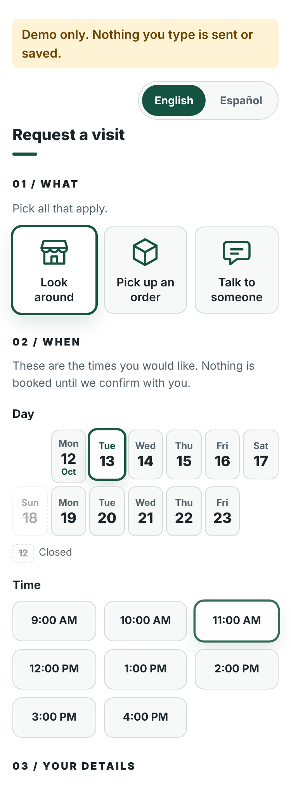

# Pásale

Pásale is a free page where your customers ask for a visit at your shop, in English or Spanish, and you get each request by email so you can call or text them to confirm.

**[Try the demo](https://pasale.fancyape.workers.dev)** (nothing you type there is sent or saved)

**Status:** Provided as-is under the MIT license. Not actively maintained; no support is offered.



## Basic setup (about 1 hour, free)

You need a free GitHub account, a free Cloudflare account and a free Resend account. You do not need to write code: you edit one settings file in your web browser.

1. **Fill in your details.** Click **Fork** (top right) to make your own copy. Open `config/pasale.config.js`, click the pencil icon, change the business name, phone, address, the email where requests should go, opening hours and services, and click **Commit changes**. Four ready-made examples (barber, mobile mechanic, clinic, showroom) are in `examples/`.
2. **Set up email.** Sign up for Resend (https://resend.com) using the same email where you want requests to arrive (free, no domain needed). Make an API key and keep it handy. To send to a different address, verify a domain you own (~$12/yr).
3. **Put it online and test it.** In Cloudflare go to **Workers & Pages, Create, Import a repository**, pick your copy and deploy. Add a secret named `RESEND_API_KEY` with your key, and in `wrangler.jsonc` change `"DEMO_MODE": "true"` to `"false"`. Send a request in English and again in Spanish, and check that the email arrives. Print the window sign at `/sign`.

Running tests? Also run: npx playwright install chromium

Stuck? The technical details below explain each step. The default page is plain on purpose: every feature in the next section is **off** unless you add its field to your config.

## Showcase: a fully customized example

[`examples/fancyape/`](examples/fancyape/fancyape.config.js) is a demo page with every optional feature turned on, for the example business "Fancy Ape". One config file produces the whole page; the page's **How this page is built** toggle shows that file, read-only. Nothing is sent or saved (`demo: true`).

Preview it locally: `npm run showcase`, then open http://localhost:3000.
Deploy it as its own Worker: `npx wrangler deploy --env showcase` (the default deployment is unchanged).

| Optional feature | Config field that enables it |
| --- | --- |
| Message prompt changes with the selected visit type (EN/ES) | `servicePrompts: { <service id>: { en, es } }` |
| Pick one visit type instead of several | `serviceSelect: 'single'` |
| Gallery strip, up to 3 items: image, its pixel `width` and `height`, an optional title (without one, only the artist shows under the frame), optional artist and link. Images are local files in the example's `images/` folder (no hotlinking), served exactly as uploaded. Frames share one height (300px from 1024px wide up, wrapping to more rows when they do not fit the column) and take each image's own shape (4:3 if no size is given); `node scripts/build-showcase.js` checks the sizes against the files. A missing image shows a placeholder frame. Optional `galleryTitle` (heading on wide screens), `galleryCredit` (one-line credit under the strip on phones) and `galleryCollection` (named in the alt text). The gallery and the config viewer load from `extras.js`/`extras.css` only when used, so the default page never downloads them | `gallery: [{ image, width, height, title?: { en, es }, artist, link }]`, `galleryTitle`, `galleryCredit`, `galleryCollection` (each `{ en, es }`) |
| Colors | `theme: { background, surface, text, textMuted, border, accent, accentHover, accentSecondary, notice, noticeText, footer }` (hex colors, all optional, applied as CSS variables). `accentSecondary` is for non-text only (rules, heading underline, focus rings). The showcase theme is checked for WCAG AA contrast |
| A note about the hours, shown directly above the day picker (and instead of the hours when they are unset; a demo with unset hours then lets visitors request a visit without picking a time) | `hoursNote: { en, es }` |
| Quieter header and smaller visit-type cards (colors are not affected; a theme never changes layout) | `layout: 'compact'` |
| Footer line, e.g. "Scheduling powered by Pásale." | `attribution: { en, es }` |
| Header line, sub-line and place line in place of the plain name and address | `header: { line, subline, location }` (each `{ en, es }`) |
| "How this page is built" toggle showing the config file, read-only | `showConfig: true` (requires `demo: true`) |

Notes:
- With `demo: true`, phone and address may be empty, and if every day is closed and `hoursNote` is set, visitors can request a visit without choosing a time. A real (non-demo) page still needs a phone, an address and opening hours.
- In demo mode the browser sends nothing at all: the confirmation is built locally.
- Add your own artwork: see `examples/fancyape/images/README.md`.

---

## Technical details

A free, bilingual (English/Spanish) **visit-request page** for small businesses.
A customer picks what they need and a *preferred* day and time, leaves a name and a
phone number, and gets a **Visit Ticket**. The owner gets an email with the same
reference number and confirms by phone or text.

Pásale does **not** book anything. No database, accounts, payments, calendar sync or
live availability.

## What customers get

- One page, three sections: **01 / What**, **02 / When**, **03 / Your details**.
- English/Spanish toggle on every screen.
- After a successful send: a ticket with the business name, a reference such as
  `PS-7K42M`, the preferred time, **"Not confirmed yet / Aún no confirmada"**, a
  tap-to-call button, the address, and your follow-up line ("Haven't heard back? Call us.").
- If sending fails: no ticket. They see "Couldn't send. Call us." with a tap-to-call
  link, and everything they typed is still on the screen.

## What "sent" means

A request counts as sent when your email provider (or webhook) **accepted** it. That is
not a guarantee that it reached your inbox: email can still be delayed, filtered or
bounced after acceptance. Check your spam folder, use a sender address your provider
allows, and keep your phone number on the ticket (it is always shown) so customers can
reach you. The reference number is a label to quote on a call. There is no database to
look it up in, so your notification email is the record.

## Run it on your computer

Needs Node.js 20+.

```
npm install
npm run demo
```

Open http://localhost:3000, submit a request, and watch it arrive in the terminal
(a stand-in for your inbox). `http://localhost:3000/sign` is the printable window sign.

## Deploying

The basic steps are at the top of this page. Details for each way of hosting it:

### Deploy to Cloudflare (primary)

Pásale deploys as a **Cloudflare Worker with static assets** (`wrangler.jsonc`). Cloudflare's
free plan allows commercial use (check Cloudflare's current terms).

1. In the Cloudflare dashboard go to **Workers & Pages → Create → Import a repository** and pick your fork.
2. Worker name `pasale` (or your own: the URL becomes `https://<name>.<your-subdomain>.workers.dev`).
   Build command: *(none)*. Deploy command: `npx wrangler deploy`.
3. This repo ships as the **public demo**: `wrangler.jsonc` sets `DEMO_MODE` to `"true"`, which shows a banner
   and sends nothing.
4. **For a real business**, edit `wrangler.jsonc`: set `"DEMO_MODE": "false"` and push. Then add the secret
   `RESEND_API_KEY` (**Worker → Settings → Variables and Secrets**, type *Secret*). Never put secrets in the file.
   Variables in `wrangler.jsonc` are applied on every deploy, so change them in the file, not only in the dashboard.
5. Static files in `public/` are served by Cloudflare; only `/api/*` and `/sign` run the Worker
   (`run_worker_first`). Security headers come from `public/_headers` and from the Worker itself.
6. If a secret or setting is wrong, the page shows a plain error and the Worker logs list exactly what is missing.

Try it locally in the real Workers runtime: `npx wrangler dev`.

### Self-host with Node

`npm start` runs the same code as a plain Node server (any host that runs Node 20+).
Set `RESEND_API_KEY` in the environment. Behind one proxy set `security.trustProxy: true`.
Free hosts that sleep idle apps make the first visit slow, which is why Cloudflare
is the recommended path. Run one instance.

### Other delivery option: webhook

`delivery: { type: 'webhook' }` plus the secret `PASALE_WEBHOOK_URL`. Pásale POSTs JSON
(`ref`, `name`, `phone`, `services`, `preferred`, `note`, `consentToText`, `language`, and
readable `text`/`content`). Works with Make, Zapier, n8n or your own endpoint; chat webhooks
that read `text` or `content` may display it directly, so test yours.

## The owner's email

Subject and body carry the reference, name, phone, services, preferred time and note.
**Call** and **Text** buttons are included. The text button opens a prefilled confirmation in the
customer's language, and appears only if they ticked "OK to text me". All customer text
is HTML-escaped.

## Preferred times, not availability

Days and times come from your weekly hours, blackout dates, slot length, days ahead and
minimum notice, in your time zone. Customers see them as *preferred* times; nothing is
reserved. The server re-checks every request against the same rules.

## Window sign

`/sign` is a printable US Letter poster: "COME BY. / PÁSALE.", your business name, a QR
code to `business.publicUrl`, and short English/Spanish instructions. The QR code is
generated by this app (no outside QR service); the sign carries no Pásale branding.

## Privacy

- Collected: name, phone, services, preferred time, an optional note, and whether it is OK to text.
- Stored by Pásale: nothing. Data lives in your email or webhook destination.
- Logs record request id, path and status only: never names, phones, notes or IPs.
- No analytics, cookies, third-party scripts, fonts or map embeds. The address on the
  ticket is a plain link that opens a map only if the customer taps it.
- Edit the privacy line in `copy` to match your own policy. You are responsible for how
  you handle the requests you receive.

## Spam protection and limits

Hidden honeypot field, strict server-side validation, size and content-type limits, and a
per-visitor rate limit (default 5 per hour).

**The rate limit and duplicate-submit protection are held in memory, per instance.** On
Cloudflare they are per isolate and reset when the isolate restarts, so the limit is
approximate. The honeypot blocks most spam anyway. The "Send" button also disables itself
while a request is in flight.

## Credit

A small "Made with Pásale" link appears at the bottom of the form (never on the ticket or
sign). Remove it with `showCredit: false`.

## Tests

```
npm test
```

Covers: successful delivery (real HTTP to a stand-in provider), provider failures (401, 422,
429, 500, unreachable) giving an error and no ticket, retries, duplicate and concurrent
submits, reference format, validation and injection attempts, honeypot, rate limiting,
log privacy, config errors, scheduling and time zones, both languages, the Cloudflare
Worker called as the platform calls it, page weight, pinned dependencies and the sign.
Phone-width layout and real inbox delivery are checked by hand (step 5 above).

## Scope

No database, accounts, payments, automated SMS, calendar sync, live availability, image
export, animation libraries or custom icon sets. Every dependency (including the `wrangler` dev tool) is pinned to an exact version.

## License

MIT, see `LICENSE`. Copyright (c) 2026 The Composition Group LLC.
